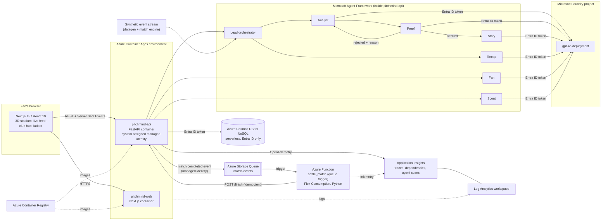
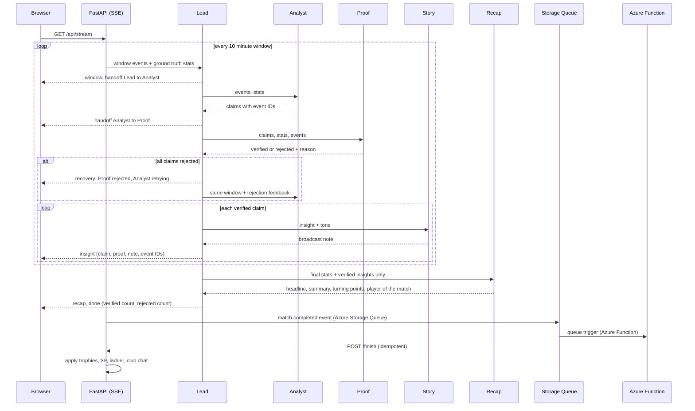

# PitchMind

**A team of AI agents that turns synthetic football events into live, verified match intelligence. No claim reaches the fan until a Proof agent checks it against the raw event data.**

Built for the **Microsoft x Premier League "Inside the Game" Developer Hackathon**.

All data is synthetic. Every club, player and match is fictional. No real Premier League data is used.

---

## Contents

1. [The problem](#the-problem)
2. [What PitchMind does](#what-pitchmind-does)
3. [Architecture](#architecture)
4. [Microsoft and Azure services used](#microsoft-and-azure-services-used)
5. [The agent team](#the-agent-team)
6. [Orchestration flow](#orchestration-flow)
7. [Observability](#observability)
8. [Event driven settlement](#event-driven-settlement)
9. [Failure recovery](#failure-recovery)
10. [Synthetic data](#synthetic-data)
11. [Fan game layer](#fan-game-layer)
12. [Frontend](#frontend)
13. [API reference](#api-reference)
14. [Security](#security)
15. [Project structure](#project-structure)
16. [Run locally](#run-locally)
17. [Deploy to Azure](#deploy-to-azure)
18. [Roadmap](#roadmap)

---

## The problem

A football match produces hundreds of events: passes, shots, tackles, pressures, turnovers. Broadcasters, studios and streaming platforms want to turn those events into live stories, stats and recaps. Large language models can write that commentary fast, but they also invent numbers. One wrong stat on air damages trust in the broadcast.

## What PitchMind does

PitchMind replays a match event by event. A team of specialised agents works on each 10 minute window of play:

* The **Analyst** finds the story in the raw events and makes claims backed by event IDs.
* The **Proof** agent checks every claim against ground truth stats that are computed in code, not by a model.
* Rejected claims go back to the Analyst with the reason, and the Analyst retries.
* Only verified claims reach the **Story** agent, which writes short broadcast style commentary.
* At full time the **Recap** agent writes the match report from verified insights only.
* The **Fan** agent rewrites any note for a kids, casual or tactical audience.
* The **Scout** agent builds fictional clubs for the fan game.

Each verified note in the UI carries its proof and the event IDs behind it, so every line of commentary can be explained.

In a recorded run on the deployed system, the agents shipped **28 verified notes** and **rejected 1 claim** before it reached the fan.

---

## Architecture



Static copies of both diagrams: [`docs/architecture.png`](docs/architecture.png) and [`docs/match-flow.png`](docs/match-flow.png).

### How a match flows through the system



---

## Microsoft and Azure services used

| Service | What it does in PitchMind |
|---|---|
| **Microsoft Foundry** | Hosts the project `pitchmind` and the **gpt-4o** model deployment that every agent calls. Accessed with the Foundry project endpoint. |
| **Microsoft Agent Framework** (`agent-framework` Python package) | Each agent is created with `FoundryChatClient(...).as_agent(name, instructions)`. Six agents share one client and are coordinated by the Lead orchestrator. |
| **Azure Container Apps** | Runs two containers, `pitchmind-api` (FastAPI, 0.5 vCPU, 1 GiB) and `pitchmind-web` (Next.js, scales 1 to 2 replicas), in one managed environment with HTTPS ingress. |
| **Azure Cosmos DB for NoSQL** (serverless) | Stores managers, clubs, squads, chat and match history. Database `pitchmind`, container `league`, partition key `/pk`. Key auth is turned off (`disableLocalAuth: true`). |
| **Azure Functions** (Flex Consumption, Python) | Event driven worker `settle_match`. A queue trigger fires when a match reaches full time on the server and settles the result (trophies, XP, ladder), even if the viewer closed the page. |
| **Azure Storage Queue** | Event bus between the API and the Function. Queue `match-events`, message type `match.completed`. The API publishes with a managed identity (Storage Queue Data Message Sender). The Function reads with its own identity (Storage Queue Data Contributor). Failed messages retry 5 times, then go to the poison queue. |
| **Application Insights** (with OpenTelemetry) | Traces every agent call, every 10 minute window, every Proof verdict and the full time settlement. See [Observability](#observability). |
| **Microsoft Entra ID / managed identity** | The API container has a system assigned managed identity. It gets the **Azure AI User** role on Foundry and the **Cosmos DB Built-in Data Contributor** role on Cosmos. No keys are stored in the app. |
| **Azure Container Registry** | `az acr build` builds both Docker images in the cloud, so no local Docker is needed. |
| **Log Analytics workspace** | Backs Application Insights and collects console logs from the Container Apps environment, including agent retries and recovery notes. |
| **Azure Resource Manager template** | `deploy/pitchmind.json` declares the Container Apps environment, both apps, Cosmos account, database, container, Application Insights, the storage account and queue, and all role assignments. |
| **Azure CLI** | `deploy/deploy.ps1` runs the full deploy with built in `az` commands. `deploy/deploy-functions.ps1` publishes the Function. |
| **Azure Identity SDK** | `DefaultAzureCredential` in Azure, `AzureCliCredential` on a developer machine. |
| **Azure Cosmos DB Python SDK** | `azure-cosmos` with Entra ID credentials for the league store. |
| **Azure Monitor OpenTelemetry distro** | `azure-monitor-opentelemetry` sends traces and logs to Application Insights. |
| **Azure Storage Queue SDK** | `azure-storage-queue` publishes events with Entra ID credentials. |

---

## The agent team

| Agent | Type | Job | Output |
|---|---|---|---|
| **Lead** | Python orchestrator | Splits the match into windows, computes ground truth stats, routes work, retries, applies fallbacks, streams every step | SSE messages |
| **Analyst** | Agent Framework agent on gpt-4o | Finds 1 to 3 claims per window. Every claim must name a metric, a value and event IDs | JSON insights |
| **Proof** | Agent Framework agent on gpt-4o | Checks each claim against stats computed in code and the raw events. Verifies or rejects with a reason | JSON verdicts |
| **Story** | Agent Framework agent on gpt-4o | Turns one verified insight into a short note in the chosen tone (broadcast, pundit, family) | Text |
| **Recap** | Agent Framework agent on gpt-4o | Writes the full time report from verified insights only | JSON headline, summary, turning points, player of the match, voiceover |
| **Fan** | Agent Framework agent on gpt-4o | Rewrites a note for a kids, casual or tactical fan, keeping every fact the same | Text |
| **Scout** | Agent Framework agent on gpt-4o | Builds a fictional club from a manager's idea: name, motto, colours, style, 11 players | JSON club |

Agent instructions live in `backend/pitchmind/agents.py`. Each agent has one job and one set of rules.

### Why multiple agents

A single agent asked to find, check and narrate tends to check its own work and approve it. PitchMind separates these jobs:

* **Ground truth comes from code.** `stats.py` computes shots, xG, pass accuracy, pressures, tackles won, final third actions and turnovers. The models never compute the numbers the Proof agent checks against.
* **Proof is independent.** It sees the claims, the computed stats and the raw events, but not the Analyst's reasoning.
* **Story never sees unverified claims.** It cannot add a stat that was not proven.
* **Recap works only from verified insights,** so the full time report inherits the same guarantee.

---

## Orchestration flow

Shared state lives in a `MatchState` dataclass (`backend/pitchmind/orchestrator.py`):

```python
@dataclass
class MatchState:
    match: dict
    insights: list   # verified insights with notes
    rejected: list   # claims Proof refused
    log: list        # trace of handoffs and recoveries
    recap: dict | None
```

For each window:

1. Lead slices events for the window and computes ground truth with `stats.team_stats`.
2. Lead hands off to Analyst with stats and compact events.
3. Analyst returns claims. Lead hands off to Proof.
4. Proof returns a verdict per claim.
5. If every claim is rejected, Lead sends the rejections back to Analyst as feedback (up to 2 attempts).
6. Each verified claim goes to Story, then to the fan as an `insight` message.

Every step is streamed to the browser as a typed Server Sent Event:

| Event | Meaning |
|---|---|
| `window` | A new window started, with the current score |
| `handoff` | Work moved from one agent to another |
| `insight` | A verified claim with proof, event IDs and the Story note |
| `recovery` | A retry, a rejection loop or a fallback |
| `recap` | The full time report |
| `done` | Final counts of verified and rejected claims |
| `ping` | Keep alive every 10 seconds while agents think |

The UI shows the live agent pipeline, a handoff trace and an AI overview with verified and rejected counts.

---

## Observability

The API is instrumented with OpenTelemetry and sends data to **Application Insights** when `APPLICATIONINSIGHTS_CONNECTION_STRING` is set (Azure sets it automatically). Locally the same calls are no-ops.

| Span | Attributes | Why it matters |
|---|---|---|
| `match.run` | match id, teams, tone, verified count, rejected count | One trace per match |
| `match.window` | match id, window start and end | Time spent per 10 minute window |
| `agent.analyst`, `agent.proof`, `agent.story`, `agent.recap` | agent name, attempt number, prompt size, reply size, `gen_ai.operation.name` | Latency, retries and failures per agent |
| `proof.verdict` | claims, verified, rejected, and a `claim_rejected` event with the reason | Shows exactly what Proof stopped |
| `match.full_time` | match id, `settled_by` (`azure-function` or `api`) | Shows the event driven path |

Agent handoffs and recoveries are recorded as span events on the window trace. Open **Application Insights > Investigate > Transaction search** to follow a match, or **Application map** to see the API, Foundry and Cosmos DB calls together. `GET /api/health` reports `telemetry` and `events` as `true` when both are wired up.

---

## Event driven settlement

When a match finishes on the server, the API publishes a `match.completed` event to an Azure Storage Queue. An Azure Function picks it up and tells the API to settle the result.

1. The agent stream reaches full time on the server, whether or not the viewer is still connected.
2. `announce_full_time` queues `{"type": "match.completed", "match_id": "..."}`.
3. The `settle_match` Function (queue trigger) calls `POST /api/challenge/{id}/finish`.
4. The API applies trophies, XP and the ladder once. The endpoint is idempotent, so retries and the page's own call at full time are safe.

If the queue is not configured (local runs) the API settles in process, so the game works everywhere. Function code is in `functions/`.

---

## Failure recovery

| Failure | What happens |
|---|---|
| Model call times out or errors | Retried up to 3 times with backoff (`CALL_TIMEOUT = 40s`). Each retry is logged and streamed as `recovery`. |
| Analyst fails for a window | Window is skipped and the match keeps going. |
| Proof is unavailable | All claims in that window are treated as rejected. Nothing unverified reaches the fan. |
| Proof rejects every claim | Analyst retries with the rejection reasons. |
| Story fails | The verified claim text is shown as is. |
| Recap fails | A fallback recap with the final score and verified insights is shown. |
| Scout fails or takes over 45s | An offline club builder creates a club so the user is never stuck. |
| Queue publish fails | The API settles the match in process instead. |
| Function cannot settle (API busy) | The queue retries up to 5 times, then moves the message to the poison queue. A 404 (match no longer in API memory) is dropped. |
| Cosmos DB not ready | The league API returns 503 "warming up" and retries the connection every 8 seconds. |
| Stream goes quiet | The UI shows "Agents thinking" with a timer and reports a lost stream after 25 seconds. |

---

## Synthetic data

* `datagen/generate_match.py` builds a full fictional match (`data/match_001.json`): 339 events with minute, second, team, player, type, zone, outcome, xG and details.
* `backend/pitchmind/engine.py` simulates new matches between user clubs. Each club's style (possession, press, counter, direct), squad ratings and midfield strength shape the event mix, pass success and goal chances.
* The Scout agent is told to create fictional names only. `league.clean_club` also blocks real club names before saving.

---

## Fan game layer

PitchMind adds a light club game so fans come back:

* **Sign in** as a manager with a name and avatar (demo sign in, no password).
* **Build a club with AI.** Describe your dream club and the Scout agent drafts it. Every field can be edited before saving.
* **Join code.** Share a 6 character code. Up to 30 members per club.
* **Club chat** with system messages for joins and results.
* **Rivals.** The 8 clubs nearest in trophies.
* **Challenge** a rival. The match engine simulates it and the agent team calls it live in the 3D stadium.
* **Trophies and ladder.** Win +30, draw +8, loss −18. XP and levels. Top 50 ladder.

---

## Frontend

* **Next.js 15 and React 19**, TypeScript.
* **3D stadium** built with CSS 3D transforms and container query units: stands, floodlights, scoreboard, players in kit colours and a moving ball synced to events.
* **Live feed** with play by play calls, goal ceremonies and verified notes with a "Show proof" panel and event IDs.
* **Notes, Timeline and Recap tabs**, momentum chart and live match stats.
* **Spoken commentary** through the browser speech API, with a toggle.
* **Fan profiles** to rewrite any note for kids, casual or tactical fans through the Fan agent.

---

## API reference

| Method | Path | Purpose |
|---|---|---|
| GET | `/api/health` | Status, model name and league store state |
| GET | `/api/match` | Match summary |
| GET | `/api/events?match=` | Events, kits, keepers and clubs for a match |
| GET | `/api/stream?tone=&speed=&match=` | Live agent run as Server Sent Events |
| POST | `/api/fan` | Fan agent rewrite for a profile |
| POST | `/api/auth/login` | Create or resume a manager |
| GET | `/api/me` | Current manager and club |
| POST | `/api/club/ai` | Scout agent drafts a club |
| POST / PUT | `/api/club` | Create or update a club |
| POST | `/api/club/join` | Join with a code |
| POST | `/api/club/leave` | Leave a club |
| GET / POST | `/api/club/chat` | Read or send club chat |
| GET | `/api/club/rivals` | Nearest rivals |
| GET | `/api/ladder` | Trophy ladder |
| POST | `/api/challenge` | Start a match against a rival |
| POST | `/api/challenge/{id}/finish` | Settle the result once. Called by the Azure Function and by the page |

The manager is identified by the `X-User` header.

---

## Security

* **No secrets in code.** Foundry and Cosmos DB are reached with Entra ID tokens through managed identity in Azure and `az login` locally.
* **Cosmos DB key auth is disabled.** Only identities with the data role can read or write.
* **Least privilege roles.** Azure AI User on the Foundry resource only. Cosmos DB Built-in Data Contributor on one account only. The API can only send queue messages. The Function can only use the queue.
* **Keyless event bus.** Both the API and the Function reach the queue with managed identities.
* **Input limits.** Club ideas are capped at 400 characters, chat at 240, names at 28. AI drafts are cleaned before saving.
* `.env` files are git ignored.

---

## Project structure

```
pitchmind/
├── backend/
│   ├── main.py                 FastAPI app, SSE stream, league endpoints
│   ├── requirements.txt
│   ├── .env.example
│   ├── cli_run.py              Run a match from the terminal
│   ├── smoke_test.py           End to end check against Foundry
│   └── pitchmind/
│       ├── agents.py           Agent instructions and Agent Framework setup
│       ├── orchestrator.py     Lead orchestrator, shared state, retries
│       ├── stats.py            Ground truth stats computed in code
│       ├── engine.py           Match simulation for user clubs
│       ├── league.py           Managers, clubs, chat, ladder, trophies
│       ├── store.py            Cosmos DB store with local file fallback
│       ├── telemetry.py        OpenTelemetry spans to Application Insights
│       └── events.py           Storage Queue publisher
├── web/
│   ├── app/
│   │   ├── page.tsx            Landing page
│   │   ├── login/              Manager sign in
│   │   ├── club/               Club builder, hub, chat, squad, ladder
│   │   ├── dashboard/          Live match: 3D stadium, feed, agents, recap
│   │   ├── components/         Stadium, Pitch3D, Crest, UserMenu, Mark
│   │   ├── commentary.ts       Play by play calls
│   │   └── sim.ts              Player movement between events
│   └── Dockerfile
├── functions/
│   ├── function_app.py         Queue triggered settlement Function
│   ├── host.json
│   └── requirements.txt
├── datagen/generate_match.py   Synthetic match generator
├── data/match_001.json         Demo match
├── deploy/
│   ├── pitchmind.json          ARM template
│   ├── deploy.ps1              One command deploy
│   └── deploy-functions.ps1    Publishes the Azure Function
└── backend.Dockerfile
```

---

## Run locally

### Prerequisites

* Python 3.11 or newer
* Node.js 20 or newer
* Azure CLI, signed in with `az login`
* A Microsoft Foundry project with a `gpt-4o` deployment, and the **Azure AI User** role for your account

### Backend

```powershell
cd backend
python -m venv .venv
.venv\Scripts\activate
pip install -r requirements.txt
copy .env.example .env
```

Edit `.env`:

```
FOUNDRY_PROJECT_ENDPOINT=https://<your-foundry>.services.ai.azure.com/api/projects/<project>
FOUNDRY_MODEL=gpt-4o
USE_AZURE_CLI=1
# Optional. Without it, the league saves to data/league.json
COSMOS_ENDPOINT=https://<your-cosmos>.documents.azure.com:443/
```

```powershell
uvicorn main:app --port 8000
```

Look for `[League] cosmos store ready` or `[League] file store ready`.

### Frontend

```powershell
cd web
npm install
npm run dev
```

Open http://localhost:3000

### Generate a new synthetic match

```powershell
python datagen/generate_match.py --seed 7 --out data/match_001.json
```

---

## Deploy to Azure

```powershell
.\deploy\deploy.ps1
```

The script:

1. Finds the Foundry resource and registers the needed resource providers.
2. Creates the resource group and Azure Container Registry.
3. Builds the API image with `az acr build`.
4. Deploys the ARM template: Log Analytics, Application Insights, Container Apps environment, API app with managed identity, Cosmos DB account, database and container, storage account with the `match-events` queue, and the data roles.
5. Grants the API identity the Azure AI User role on Foundry.
6. Grants your own account Cosmos access for local development.
7. Builds and deploys the web image with the API URL.
8. Publishes the `settle_match` Azure Function (Flex Consumption) with its own identity and queue access. This step is optional: if it is skipped, the API settles in process.
9. Waits for `/api/health` to report the league ready.

Set `PITCHMIND_COSMOS_LOCATION` to choose a different Cosmos DB region.

---

## Roadmap

* Azure AI Speech neural voices for spoken commentary.
* Shared live viewing for club mates through Azure Web PubSub.
* Managed identity image pulls from Azure Container Registry instead of admin credentials.
* More events on the queue (goal, verified insight) for broadcaster and studio integrations through Event Grid.
* Run agent evaluations in Foundry against the synthetic match set to track Proof accuracy over time.
